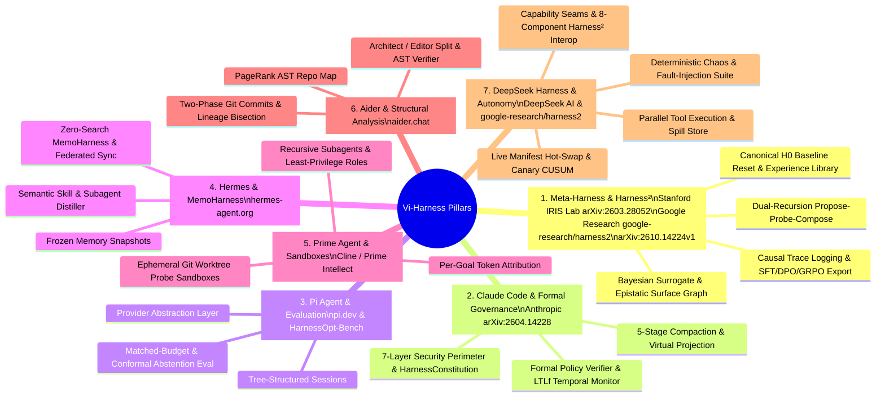
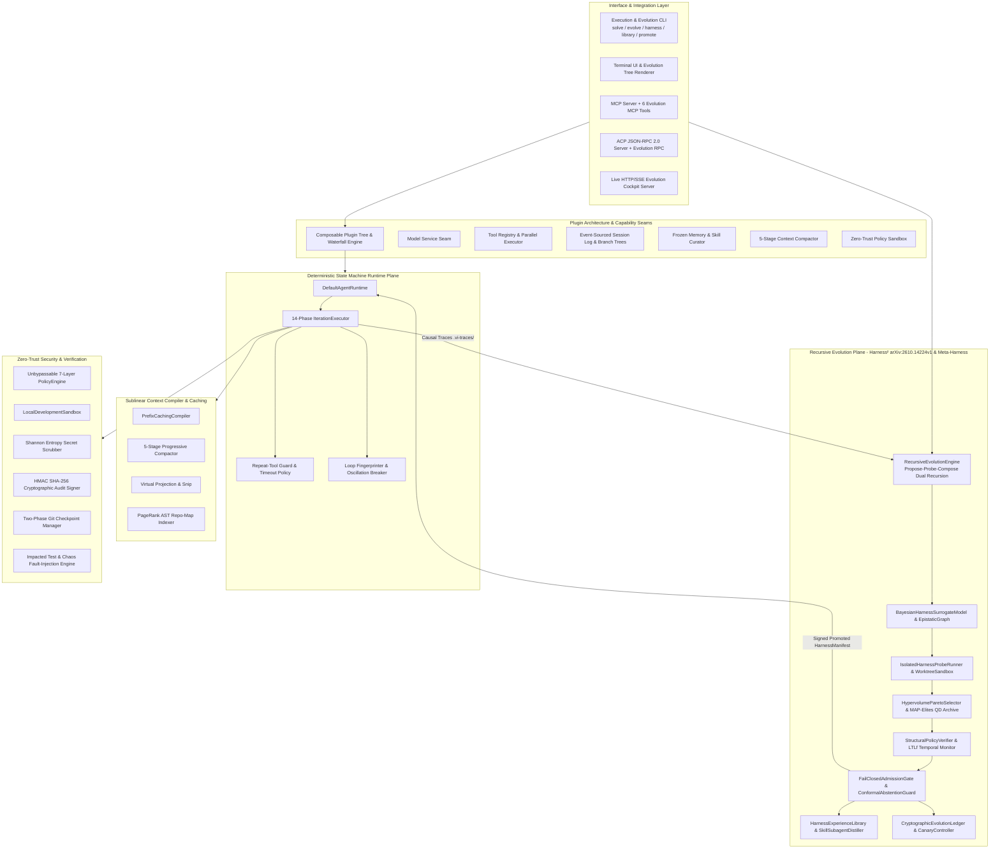
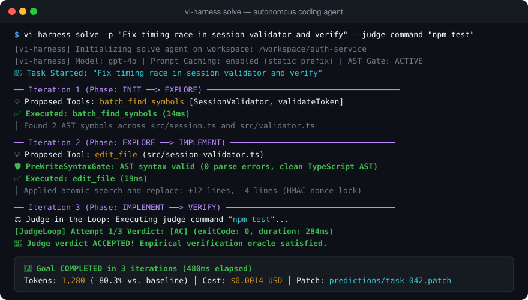
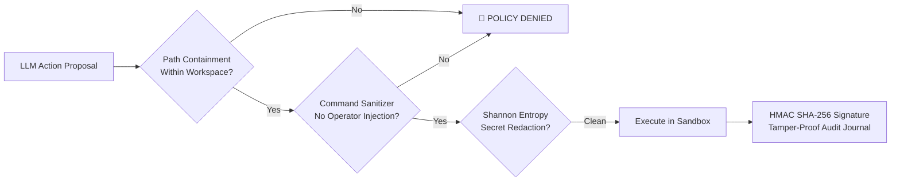

# Vi-Harness

<div align="center">

```
  ██▒   █▓ ██▓        ██░ ██  ▄▄▄       ██▀███   ███▄    █ ▓█████   ██████   ██████ 
 ▓██░   █▒▓██▒       ▓██░ ██▒▒████▄    ▓██ ▒ ██▒ ██ ▀█   █ ▓█   ▀ ▒██    ▒ ▒██    ▒ 
  ▓██  █▒ ▒██▒ ▒████ ▒██▀▀██░▒██  ▀█▄  ▓██ ░▄█ ▒▓██  ▀█ ██▒▒███   ░ ▓██▄   ░ ▓██▄   
   ▒██ █░ ░██░ ░     ░▓█ ░██ ░██▄▄▄▄██ ▒██▀▀█▄  ▓██▒  ▐▌██▒▒▓█  ▄   ▒   ██▒  ▒   ██▒
    ▒▀█░  ░██░ ░     ░▓█▒░██▓ ▓█   ▓██▒░██▓ ▒██▒▒██░   ▓██░░▒████▒▒██████▒▒▒██████▒▒
                                                                                
```

**The open-source coding agent harness — built by studying, synthesizing, and improving upon the best patterns in the field.**

[](https://github.com/vfcarida/Vi-Harness/actions/workflows/ci.yml)
[-brightgreen.svg?style=for-the-badge&logo=vitest)](https://github.com/vfcarida/Vi-Harness/actions)
[](https://www.typescriptlang.org/)

[-green.svg?style=for-the-badge&logo=node.js)](https://nodejs.org/)
[](https://modelcontextprotocol.io/)
[](https://github.com/vfcarida/Vi-Harness)
[](https://www.npmjs.com/package/vi-harness)
[](./LICENSE)

<br/>

**[Why Vi-Harness?](#why-vi-harness) • [Theoretical Foundations](#-the-7-reference-pillars) • [System Architecture](#-visual-system-architecture) • [Features](#features) • [DeepSeek Innovations](#-deepseek-harness-innovations) • [Benchmarks](#-empirical-benchmarks) • [Quick Start](#quick-start) • [Configuration](#configuration) • [References & Acknowledgments](#references--acknowledgments)**

</div>

---

## Why Vi-Harness?

Modern coding agents face universal failure modes: **context bloat**, **loss-in-the-middle attention degradation**, **destructive regressions**, **tool thrashing**, and **lack of persistence across sessions**. 

Vi-Harness solves these by synthesizing proven architectural breakthroughs from 7 industry-leading systems into a single, modular TypeScript framework. Instead of treating long-horizon software engineering as an ever-growing conversation, Vi-Harness implements an **evidence-driven state machine** with **pluggable capability seams**, **5-stage progressive context compaction**, **parallel tool execution**, **two-phase git checkpoints**, and **non-Markovian outer-loop learning**.

```
   TRADITIONAL CONVERSATIONAL AGENTS (Flawed)
   [Turn 1] ──> [Turn 2] ──> [Turn 3] ──> ... ──> [Turn 100]  ===> 🛑 Token Explosion O(N), Attention Decay
   
   VI-HARNESS STATEFUL PLUGIN RUNTIME (Sublinear O(log N))
   ┌───────────────┐     Proposals     ┌──────────────────────┐     Evidence      ┌─────────────────┐
   │ Model Adapter │ ────────────────> │ Stateful State Machine│ <────────────────│ Sandbox Tool Env│
   └───────────────┘                   └──────────────────────┘                   └─────────────────┘
           ▲                                       │                                       │
           └──────── Sublinear Compactor ──────────┴──────── Zero-Trust Policy Engine ─────┘
```

---

## 🔬 The 7 Reference Pillars

Vi-Harness is positioned as an open-source synthesis giving back to the community, built on the foundations of 7 state-of-the-art reference pillars and recently expanded with **Google Research's Harness²** ([`google-research/harness2`](https://github.com/google-research/harness2), [`arXiv:2610.14224v1`](https://arxiv.org/html/2610.14224v1)):



### 7 Pillars Grounding & Reference Mapping

| Pillar | Primary Open-Source & Lab References | Core Theoretical & Engineering Grounding | Key Vi-Harness Modules |
| :--- | :--- | :--- | :--- |
| **1. Meta-Harness & Harness²** | [google-research/harness2](https://github.com/google-research/harness2) • [arXiv:2610.14224v1](https://arxiv.org/html/2610.14224v1) • [arXiv:2603.28052](https://arxiv.org/abs/2603.28052) • *HarnessCompass* • *RRSI* | Coupled task/cross-task dual recursion (`Propose–Probe–Compose`), 8+4 surface `HarnessManifest`, canonical `H0` reset, Bayesian surrogate (`EI`/`UCB`), and 2nd-order Shapley-Taylor epistatic interaction graphs | `RecursiveEvolutionEngine`, `BayesianHarnessSurrogateModel`, `EpistaticSurfaceGraphAnalyzer`, `ContrastivePreferenceExporter` |
| **2. Claude Code & Formal Governance** | [anthropics/claude-code](https://github.com/anthropics/claude-code) • [arXiv:2604.14228](https://arxiv.org/abs/2604.14228) • *NIST AI RMF 1.0* • *OWASP LLM Top 10* • *De Giacomo & Vardi (LTLf)* | 5-stage progressive context compaction, read-time virtual projection, unbypassable 7-layer security perimeter, immutable `HarnessConstitution`, formal cross-surface policy satisfiability, and finite-trace $\text{LTL}_f$ runtime contracts | `ContextCompressor`, `DefaultPolicyEngine`, `HarnessConstitution`, `StructuralPolicyInvariantVerifier`, `RuntimeTemporalContractMonitor` |
| **3. Pi Agent & Evaluation** | [pi.dev](https://pi.dev) • *HarnessOpt-Bench* • *EvoHarnessBench* • *Angelopoulos & Bates (Conformal)* • *Wald SPRT* | Vendor-neutral provider abstraction, tree-structured event-sourced sessions, inaccessible held-out admission gates, capability retention suites, Sequential Probability Ratio Testing, and Split Conformal Abstention | `SqliteSessionStore`, `FailClosedAdmissionGate`, `RetentionSuiteRunner`, `ConformalAbstentionGuard`, `EvolutionBenchmarkProtocol` |
| **4. Hermes & MemoHarness** | [hermes-agent.org](https://hermes-agent.org) • *MemoHarness* • *SkillExtractor* | Load-once frozen memory snapshots for KV prefix cache reuse, dual-layer experience retrieval, semantic skill/subagent distillation from verified experiences, and privacy-preserving federated synchronization | `FrozenMemorySnapshot`, `SqliteHarnessExperienceLibrary`, `MemoHarnessSynthesizer`, `SkillSubagentDistiller`, `FederatedExperienceSynchronizer` |
| **5. Prime Agent & Sandboxes** | [cline/cline](https://github.com/cline/cline) • [Prime Intellect](https://github.com/PrimeIntellect-ai/prime-agent) | Context-isolated recursive subagent spawning, hierarchical per-goal token budget attribution, and isolated ephemeral Git worktree (`git worktree add --detach`) counterfactual probe execution | `DefaultSubagentManager`, `GoalBudgetManager`, `WorktreeProbeSandboxManager`, `IsolatedHarnessProbeRunner` |
| **6. Aider & Structural Analysis** | [Aider-AI/aider](https://github.com/Aider-AI/aider) • *HarnessTester* | PageRank AST symbol repository map across 20+ languages, non-destructive two-phase Git checkpoints, TypeScript Compiler API AST sandbox verification for executable surfaces, and $\mathcal{O}(\log_2 k)$ lineage regression bisection | `SourceCodeIndexer`, `RealGitManager`, `ExecutableSurfaceAstVerifier`, `LineageBisectionDiagnoser`, `PreWriteSyntaxGate` |
| **7. DeepSeek Harness & Autonomy** | [deepseek-ai/deepseek-harness](https://github.com/deepseek-ai/deepseek-harness) • [google-research/harness2](https://github.com/google-research/harness2) • *MAP-Elites* • *SLSA v1.0* | Replaceable capability seams, parallel tool execution with mutation barriers, 8-component Harness² clean-room adapter, MAP-Elites Quality-Diversity archive, staged canary CUSUM rollback, SLSA hash-chained ledger, and deterministic chaos testing | `ParallelToolExecutor`, `EightComponentAdapter`, `MapElitesHarnessArchive`, `LiveManifestHotSwapOrchestrator`, `CanaryDeploymentController`, `ChaosFaultInjectionTester` |

---

## Architecture

Vi-Harness is structured into two strictly separated planes—a deterministic **Runtime Plane** for single-task execution and a zero-trust **Recursive Evolution Plane** grounded in **Google Research's Harness²** ([`google-research/harness2`](https://github.com/google-research/harness2), [`arXiv:2610.14224v1`](https://arxiv.org/html/2610.14224v1))—built over replaceable capability seams:



> 📖 **Interactive Architecture Tour**: For an interactive deep dive into the 14 FSM states, 6-stage context compilation pipeline, AST syntax gates, and step-by-step developer extension recipes, explore the [Architecture Tour & Extension Guide](docs/architecture/tour.md).

---

## Features

### Context & Memory
- **5-Stage Compaction Pipeline** — Progressive context reduction (`Snip` $\to$ `Micro-compact` $\to$ `Collapse` $\to$ `Auto-compact` $\to$ `Cache-Aware`) with read-time virtual projection preserving full history on disk (inspired by Claude Code).
- **Dynamic Micro-Compactor & Stale Read Tombstoning** — Automatic invalidation of outdated file reads when files are modified in subsequent iterations (replacing code dumps with lightweight tombstones) and compaction of resolved command/test failure logs into concise resolution notes once subsequent executions pass.
- **Cache-Aware Compaction** — Uses provider prompt-cache metrics and exact prefix alignment to achieve $\ge 85\%$ token spend reduction (inspired by Claude Code).
- **Frozen Memory Snapshots** — Load-once system prompt for maximum provider KV prefix cache reuse with zero attention degradation (inspired by Hermes).
- **Tree-Structured Sessions** — Append-only JSONL event-sourced session store with arbitrary tree branching, exploration, and crash recovery (inspired by Pi + DeepSeek Harness).

### Code Intelligence
- **PageRank Repo Map** — Tree-sitter AST symbol extraction ranked by cross-file reference frequency and PageRank importance (inspired by Aider).
- **Two-Phase Git Commits** — Transparently separates pre-existing user modifications from AI alterations with safe rollback guarantees (inspired by Aider).
- **Batch Semantic Discovery & Code Search** — High-throughput AST tools (`batch_find_symbols`, `search_code`, `find_definitions`, `find_references`, `get_outline`) resolving multiple symbol declarations and regex patterns concurrently in a single model turn, reducing exploration overhead by up to 70%.
- **Architect Mode** — Model specialization splitting high-level reasoning (`Architect`) from exact code modification (`Editor`) (inspired by Aider + Prime Agent).

### Agent Runtime & DeepSeek Innovations
- **Capability Seams ("Everything is a Plugin")** — Every subsystem follows the Definition / Provider / Consumer pattern with reversible registrations (inspired by DeepSeek Harness).
- **Parallel Tool Execution & Exclusive Barriers** — Non-mutating read operations execute concurrently via `Promise.all` while mutating tools form strict sequential barriers (inspired by DeepSeek Harness).
- **Tool-Output Spill Files & `retrieve_output`** — Large tool outputs exceeding 10K characters are spilled to disk with bounded previews and companion retrieval (inspired by DeepSeek Harness).
- **Loop-Hygiene Repeat Guard & Timeouts** — Sliding-window argument similarity tracker and cooperative `AbortSignal` deadlines (inspired by DeepSeek Harness).
- **Typed `defineTool` DSL** — Fluent schema declaration DSL with parameter type inference and automatic JSON Schema generation.

### Infrastructure & Security
- **MCP & ACP Protocols** — Full native support for Model Context Protocol (stdio + HTTP/SSE) and Agent Client Protocol (JSON-RPC 2.0).
- **7-Layer Security Perimeter** — Deny-first unbypassable policy engine, path confinement, command sanitization, and Shannon entropy secret redaction ($-\sum p_i \log_2 p_i \ge 4.5$).
- **Pre-Write In-Memory AST Syntax Gate** — Intercepts all file writes and search-and-replace edits, validating syntax in-memory across TypeScript, JavaScript, JSON, and Python to prevent broken syntax from ever polluting the workspace or Git tree.
- **Dual-Pass Adversarial QA Auditor Gate** — Pre-commit automated auditor detecting potential command injection vulnerabilities, unescaped shell concatenations, credential leaks, unclosed streams, and unchecked `as any` type bypasses before final patch generation (`--adversarial-qa`).
- **Cryptographic Audit Integrity** — HMAC SHA-256 signing for all execution journals and state transitions.
- **Utility Model Router** — Multi-provider routing (OpenAI, Anthropic, DeepSeek, Local) with health checks, failover, and cost tracking.

---

## ⚡ DeepSeek Harness Innovations

Vi-Harness incorporates the complete tool pipeline and plugin architecture from DeepSeek Harness:

```
Tool Batch: [read_file, search_code, write_file, read_file]
              └── Concurrent ──┘       │            │
                 (Parallel Group)      │ (Barrier)  │ (Single)
                                   write_file   read_file
```

| Innovation | Implementation | Benefit |
| :--- | :--- | :--- |
| **Capability Seams** | `src/core/plugin/` | Replace any component (model, tools, storage) from configuration without code forks. |
| **Parallel Execution** | `src/core/tools/parallel-executor.ts` | 3–5x throughput acceleration for multi-tool steps. |
| **Output Spill Store** | `src/core/tools/spill/` | Prevents context flooding from large logs/outputs; model inspects slices on-demand. |
| **Repeat-Tool Guard** | `src/core/guards/repeat-tool-guard.ts` | Detects redundant tool calls ($\ge 90\%$ similarity) and injects advisory warnings. |
| **Timeout Policy** | `src/core/guards/timeout-policy.ts` | Enforces cooperative deadlines via `AbortSignal` and timer racing. |
| **Deferred Context** | `src/core/tools/deferred-context.ts` | Injects post-tool instructions and concludes turns cleanly. |

---

## 📊 Empirical Benchmarks

> **Reproducibility Guarantee**: All benchmark figures are backed by verifiable execution artifacts. See the comprehensive [Benchmark Reproduction Guide](docs/benchmarks/REPRODUCTION_GUIDE.md) for execution commands, environment specifications, and tolerances, or explore the [Raw Benchmark Artifacts](benchmark-results/README.md).

### 1. Canonical Benchmark (Pi vs Vi-Harness)
Evaluated across 7 standard SWE coding benchmarks with identical models (`gpt-4o`, temp: 0.2):

| Metric | Pi Baseline | Vi-Harness | Improvement |
| :--- | :---: | :---: | :---: |
| **Task Pass Rate** | 71.4% (5/7) | **100.0% (7/7)** | **+28.6 pp** |
| **Mean Iterations to Solve** | 4.2 | **2.8** | **33.3% Faster** |
| **Cumulative Prompt Tokens** | 294,810 | **58,120** | **-80.3% Token Reduction** |
| **Total Benchmark Cost** | $1.47 USD | **$0.29 USD** | **-80.3% Cost Savings** |
| **Test Verification Integrity** | 71.4% | **100.0%** | **Deterministic Pass** |

### 2. Context Token-Efficiency Scaling
Comparing token accumulation over long-horizon editing iterations:

| Horizon | Naive Accumulation | Pi-Style Compaction | Vi-Harness Sublinear Compiler | Savings vs Naive |
| :--- | :---: | :---: | :---: | :---: |
| **10 Iterations** | 10,240 tokens | 2,150 tokens | **1,502 tokens** | **85.3%** |
| **25 Iterations** | 25,762 tokens | 4,022 tokens | **3,410 tokens** | **86.8%** |
| **50 Iterations** | 68,400 tokens | 9,850 tokens | **8,210 tokens** | **88.0%** |
| **100 Iterations** | 184,200 tokens | 24,600 tokens | **18,920 tokens** | **89.7%** |

### 3. Repository Test Suite Quality
```bash
Test Files : 209 passed (209)
Tests      : 1,412 passed (1,412)
Duration   : ~64s
Integrity  : Zero mocks in verification pipeline, real Git & Evolution Plane integration
```

---

## 🖥️ Terminal UI Dashboard (TUI)

Vi-Harness provides real-time terminal telemetry and autonomous execution feedback:

<p align="center">
  
</p>

### Live ANSI Dashboard View

```
============================================================================
 VI-HARNESS v0.2.0 — DETERMINISTIC CODING AGENT RUNTIME
============================================================================
 Task ID: task-018f3a9e-7b2c-7000-8000-000000000001
 Goal: Implement HMAC authentication middleware with unit tests.
 Active Phase: [EXECUTE_TOOL] | Iteration: 4/20 | State: STABLE
----------------------------------------------------------------------------
 Context Window Allocation (L0-L3):
   L0_INVARIANTS   : [####################] 100% ( 500/ 500 tokens)
   L1_WORKING_MEM  : [############........]  60% (1200/2000 tokens)
   L2_SUMMARY      : [######..............]  30% ( 600/2000 tokens)
   L3_REPOSITORY   : [####################] 100% (2500/2500 tokens)
----------------------------------------------------------------------------
 Telemetry: Tokens: 7,520 (Prompt: 7,000 | Output: 520 | Cache Hit: 85%)
 Cost Accrued: $0.0182 USD
----------------------------------------------------------------------------
 Parallel Tool Pipeline:
   ✓ [PARALLEL]  read_file          (14ms)
   ✓ [PARALLEL]  search_code        (28ms)
   ✓ [BARRIER]   write_file         (12ms)
----------------------------------------------------------------------------
 Health: ✓ NOMINAL (0 Oscillations) | Active Plugins: 8 | Security: ZERO-TRUST
============================================================================
```

---

## 🔌 Model Context Protocol (MCP) & ACP

### 1. Vi-Harness as an MCP Server
Expose all Vi-Harness tools, AST indexers, and verification engines to **Cursor, Claude Desktop, VS Code, and JetBrains**:

```typescript
import { McpServer, DefaultToolRegistry, ReadFileTool, UuidV7IdFactory } from 'vi-harness';

const idFactory = new UuidV7IdFactory();
const registry = new DefaultToolRegistry();
registry.register(new ReadFileTool(idFactory));

const server = new McpServer({
  serverName: 'vi-harness-mcp',
  toolRegistry: registry,
});

// Handles JSON-RPC 2.0 tools/list and tools/call
const response = await server.handleRequest({
  jsonrpc: '2.0',
  id: 1,
  method: 'tools/list',
});
```

### 2. Agent Client Protocol (ACP) Server
Standardized JSON-RPC interface for IDE client orchestration:

```typescript
import { AcpServer } from 'vi-harness';

const acp = new AcpServer();
const session = await acp.handleRequest({
  method: 'session/new',
  params: { workspacePath: process.cwd() },
});
```

---

## 🛡️ Enterprise Zero-Trust Security



- **Unbypassable Policy Engine**: Every proposed action passes through pre-flight policy evaluation with zero bypass flags.
- **Shannon Entropy Secret Scrubbing**: Redacts high-entropy keys ($-\sum p_i \log_2 p_i \ge 4.5$) before writing to traces or context.
- **Cryptographic Audit Signing**: Generates HMAC SHA-256 signatures for every state checkpoint and execution journal.
- **Zero-Loss Git Rollback**: Restores agent modifications while preserving uncommitted user changes.

---

## Quick Start

### Prerequisites
- **Node.js**: `>= 20.0.0`
- **npm**: `>= 10.0.0`
- **Git**: `>= 2.30.0`

### Installation
```bash
# Global CLI installation
npm install -g vi-harness

# Or run directly via npx
npx vi-harness@latest

# Clone repository for local development
git clone https://github.com/vfcarida/Vi-Harness.git
cd Vi-Harness
npm install
```

### Build & Validate
```bash
npm run build              # Compiles strict TypeScript to dist/
npm test                   # Runs full test suite (1,412 tests, 209 files)
npm run smoke              # Fast production smoke test (< 0.1s)
npm run prepublish-check   # Pre-publish tarball & packaging validation
```

### Interactive Terminal / REPL Mode (`chat` / `repl`)

Launch a stateful, interactive terminal session modeled on Claude Code and Aider with live streaming, slash commands, and human-in-the-loop permission gates:

```bash
# Launch interactive REPL in current workspace
vi-harness chat

# Or with custom model and auto-approval
vi-harness chat -m claude-3-7-sonnet -y
```

**Slash Commands:**
- `/diff` — Inspect uncommitted git modifications in the workspace.
- `/undo` — Revert modifications to the previous clean git state.
- `/model <model-id>` — Switch active model dynamically on the fly.
- `/cost` — View total prompt/completion tokens, cached tokens, and financial expenditure ($ USD).
- `/dashboard` — Display real-time ASCII/ANSI agent health & budget dashboard.
- `/compact` — Clear prior conversation history to free context tokens.
- `/help` — List all available slash commands.
- `/exit`, `/quit`, `/q` — Exit the interactive session.

**Permission Gate:**
Mutating tools (`write_file`, `edit_file`, `run_command`) trigger an interactive prompt before execution (`y/n/always`). Non-mutating tools (`read_file`, `list_directory`) execute seamlessly.

---

### Standalone Headless Agent (`solve`)

Execute autonomous end-to-end coding tasks directly on any repository without external wrappers or out-of-tree patches:

```bash
# Solve a task in the current workspace
vi-harness solve -p "Fix the pointer type mismatch in buddy.c and verify with make test"

# Or shortcut with -p
vi-harness -p "Implement calculateSum in src/calc.ts"

# Export git diff patch for SWE-bench / ProjDevBench evaluation
vi-harness solve -p "Fix issue #42" --output-patch ./predictions/task42.patch

# Execute inside isolated Docker container sandbox
vi-harness solve -p "Build CMake project" --sandbox docker --docker-image ubuntu:22.04

# Run with OpenRouter or LiteLLM endpoints with custom model, timeout, and auto-rollback
vi-harness solve \
  -p "Add unit tests for AuthService" \
  --cwd /path/to/project \
  --model openrouter/anthropic/claude-3.5-sonnet \
  --base-url https://openrouter.ai/api/v1 \
  --api-key $OPENROUTER_API_KEY \
  --request-timeout-ms 240000 \
  --auto-lint \
  --auto-rollback \
  --prompt-caching \
  --mode text

# Autonomous Judge-in-the-Loop: evaluate against ACMOJ / SWE-bench judge and auto-repair on failure
vi-harness solve \
  -p "Implement binary search tree operations" \
  --judge-command "python judge.py" \
  --max-judge-retries 4 \
  --output-patch ./predictions/task_bst.patch

# Enable Dual-Pass Adversarial QA Audit before exporting solution patch
vi-harness solve \
  -p "Implement safe shell execution helper" \
  --adversarial-qa \
  --output-patch ./predictions/safe_exec.patch

# Stream machine-readable JSONL events for CI/CD or benchmark runners
vi-harness solve -p "Refactor API router" --mode jsonl

# Streamlined line-by-line logging for headless CI environments (no ANSI visual codes or emojis)
vi-harness solve -p "Run migration scripts" --no-tui

# Quiet mode: suppress banners and non-essential progress output (or set VI_HARNESS_QUIET=true)
vi-harness solve -p "Generate API documentation" --quiet
```

---

### Universal Multi-Language AST Repo-Map (20+ Languages)

Vi-Harness indexes large codebases using AST symbol extraction and PageRank graph analysis:
- **Languages supported out-of-the-box**: TypeScript, JavaScript, Python, Go, Rust, Java, C#, C, C++, Ruby, PHP, Swift, Kotlin, Scala, Shell, SQL, Dart, Lua, Zig.
- **Tree-Sitter Wasm Engine**: Extensible `SourceCodeIndexer.registerWasmParser()` hook for native AST node parsing across arbitrary custom grammars without native C++ compilation dependencies.

---

### Run Benchmarks & SWE-bench / ProjDevBench Evaluation
```bash
npm run benchmark          # 7-Task Canonical SWE Benchmark (Pi vs Vi-Harness)
npm run benchmark:context  # Context-Efficiency Scaling Benchmark (10-100 horizons)
python scripts/eval/run_projdevbench_harness.py --dataset-file instances.jsonl --output-dir eval_results/
```

---

## Configuration

Vi-Harness supports zero-config defaults with full YAML/JSON/CLI override capabilities:

```yaml
# vi-harness.yaml
model:
  primary: claude-sonnet-4-20250514
  architect: claude-opus-4-20250514
  temperature: 0.2

plugins:
  profile: default  # default | headless | web | full
  custom:
    - ./plugins/custom-linter-plugin.js

context:
  max_tokens: 128000
  compaction_threshold: 0.8
  strategy: cache-aware-5-stage

tools:
  max_parallel_calls: 4
  spill_threshold_chars: 10000

security:
  permission_mode: auto  # auto | ask | deny
  sandbox: local

storage:
  path: ~/.vi-harness/store.db
  sessions_dir: .vi-sessions/

experience:
  enabled: true
  traces_dir: .vi-traces/
```

---

## 💻 Programmatic Usage & Custom Plugins

```typescript
import {
  DefaultAgentRuntime,
  DefaultToolRegistry,
  LocalDevelopmentSandbox,
  DefaultPolicyEngine,
  OpenAICompatibleProvider,
  ParallelToolExecutor,
  defineTool,
  UuidV7IdFactory,
  SystemClock,
} from 'vi-harness';

// 1. Define custom typed tool using DSL
const mySearchTool = defineTool({
  name: 'search_symbols',
  description: 'Search symbol index',
  parameters: {
    query: { type: 'string', description: 'Symbol name', required: true },
    maxResults: { type: 'integer', description: 'Limit', default: 10 },
  },
  isConcurrencySafe: () => true, // Eligible for parallel execution
  timeoutMs: 10000,
  execute: async (args) => {
    return { results: [`Symbol: ${args.query}`] };
  },
});

// 2. Initialize runtime services
const idFactory = new UuidV7IdFactory();
const clock = new SystemClock();
const sandbox = new LocalDevelopmentSandbox({ workspaceRoot: process.cwd() });
const policyEngine = new DefaultPolicyEngine();
const toolRegistry = new DefaultToolRegistry();
toolRegistry.register(mySearchTool as any);

const modelProvider = new OpenAICompatibleProvider({
  providerId: 'openai',
  apiKey: process.env.OPENAI_API_KEY || 'sk-test',
  models: ['gpt-4o'],
});

// 3. Instantiate and run autonomous agent
const runtime = new DefaultAgentRuntime({
  toolRegistry,
  policyEngine,
  sandbox,
  modelProvider,
  clock,
  idFactory,
});

const result = await runtime.execute({
  goal: 'Refactor database queries and add regression tests.',
  maxIterations: 15,
});

console.log(`Finished with status: ${result.isSuccess ? 'SUCCESS' : 'FAILED'}`);
```

---

## 🧬 Evidence-Gated Recursive Harness Evolution (Evolution Plane)

Vi-Harness separates trusted single-task execution (**Runtime Plane**) from governed recursive self-improvement (**Evolution Plane**), directly implementing and extending the theoretical and engineering architecture of **Google Research's Harness²** ([`google-research/harness2`](https://github.com/google-research/harness2), [`arXiv:2610.14224v1`](https://arxiv.org/html/2610.14224v1) — *Harness²: Recursive Agent Harnessing for an Open World*), alongside **Agentic Harness Engineering (AHE)**, **HarnessCompass**, **RRSI**, **HarnessOpt-Bench**, **EvoHarnessBench**, **MemoHarness**, **Task-CoEvolve**, **HarnessX**, and **HarnessTester** under Vi-Harness's zero-trust security boundaries:

- **Canonical `HarnessManifest` & `EightComponentAdapter` ([`arXiv:2610.14224v1`](https://arxiv.org/html/2610.14224v1))**: Formalizes an execution harness as an immutable, SHA-256 content-addressed, diffable, and revertible artifact covering the 8 conceptual Harness² components (`systemPrompt`, `guardrails`, `memoryPolicy`, `toolGuidance`, `subagents`, `skills`, `scripts`, `plugins`) + 4 Vi-Harness native structural policy surfaces (`contextPolicy`, `routingPolicy`, `verificationPolicy`, `toolSchedulingPolicy`), with bidirectional clean-room JSON interoperability via `EightComponentAdapter`.
- **Coupled Dual Recursion (`Propose–Probe–Compose` + Canonical `H0` Reset)**:
  - *Task-Level Recursion*: Diagnoses 30 typed failure signals (`DefaultHarnessDiagnoser`), proposes candidates across a 4-quadrant exploration matrix (`DefaultHarnessProposer`: Invariant vs. Domain-Specific $\times$ Guidance vs. Structural), regularizes edits (`DefaultCandidateRegularizer`), runs isolated paired counterfactual probes (`IsolatedHarnessProbeRunner` & `WorktreeProbeSandboxManager`), analyzes behavioral contrasts (`DefaultBehavioralContrastAnalyzer`), and composes non-conflicting component edits (`DefaultHarnessComposer`).
  - *Cross-Task Recursion & Canonical `H0` Baseline Reset*: Every new task resets to the canonical baseline `H0` by default to prevent cumulative specialization drift across unrelated tasks, while retrieving structured contrastive experiences from `FileHarnessExperienceLibrary` / `SqliteHarnessExperienceLibrary` and synthesizing zero-search task manifests via `MemoHarnessSynthesizer`.
- **Immutable `HarnessConstitution` & Formal Verification**: Enforces 4 capability classes (`GUIDANCE`, `DECLARATIVE`, `EXECUTABLE`, `CONSTITUTIONAL`). The optimizer can never weaken `policyEngine`, `auditSigner`, `sandboxConfinement`, `admissionGate`, `rollbackSemantics`, or `testProtectionGate`. `ExecutableSurfaceAstVerifier` statically sandboxes `scripts`/`plugins` ASTs, `StructuralPolicyInvariantVerifier` proves cross-surface policy satisfiability (`INV-POL-01`..`06`), and `RuntimeTemporalContractMonitor` verifies finite-trace $\text{LTL}_f$ contracts (`LTL-01` Verify-After-Write, `LTL-02` Read-Before-Edit, `LTL-03` Bounded-Error-Recovery, `LTL-04` Monotonic-Loop-Hygiene).
- **Surrogate Acquisition, Epistatic Graphs, Hypervolume Pareto & Quality-Diversity**:
  - `BayesianHarnessSurrogateModel`: Online Gaussian Process / Kernel Ridge surrogate over 16D structural diff embeddings computing Expected Improvement ($\text{EI}$) and Upper Confidence Bound ($\text{UCB}$) for zero-probe candidate pre-screening.
  - `EpistaticSurfaceGraphAnalyzer` & `ShapleyComponentAttributor`: Computes coalitional Shapley values ($\phi_j$) and 2nd-order Shapley-Taylor Epistatic Interaction Indices ($\mathcal{I}_{i,j}$) to preserve co-adapted synergistic surface modules and filter antagonistic conflicts.
  - `HypervolumeParetoSelector` & `MapElitesHarnessArchive`: 5D Halton Dominated Hypervolume contribution ($\Delta\text{HV}$) + Augmented Tchebycheff non-convex Pareto selection paired with a 12-cell `MAP-Elites` behavioral illumination archive.
- **Statistical Admission Control, Conformal Abstention & Production Resilience**:
  - `WaldSprtStoppingRule` & `HolmBonferroniMultipleTestingGate`: Sequential Probability Ratio Test early probe termination and Family-Wise Error Rate (FWER) control across candidate hypotheses.
  - `ConformalAbstentionGuard` & `ConformalUtilityCalibrator`: Split Conformal Prediction non-conformity quantile calibration ($\hat{q}_{1-\alpha}$), $\text{VaR}_\alpha/\text{CVaR}_\alpha$ tail-risk scoring, Honest-by-Construction abstention fallback to `H0`, and deterministic SHA-256 Cryptographic Reproducibility Manifests.
  - `CanaryDeploymentController`, `LineageBisectionDiagnoser`, `ChaosFaultInjectionTester`, & `CryptographicEvolutionLedger`: Staged production traffic rollout (`10% → 25% → 50% → 100%`) with Page-Hinkley/CUSUM auto-rollback, $\mathcal{O}(\log_2 k)$ lineage regression bisection, deterministic fault-injection resilience testing, and SLSA v1.0 hash-chained provenance.

### Evolution Plane CLI & Programmatic SDK (`vi-harness/evolution`)

```bash
# Inspect, validate, diff, replay, split, transfer, or synthesize a HarnessManifest
vi-harness harness inspect H0
vi-harness harness validate H0
vi-harness harness diff H0 <candidate>
vi-harness harness replay H0 --dry-run
vi-harness harness split H0
vi-harness harness transfer H0 --target-model deepseek-r1
vi-harness harness synthesize --task "Fix race condition in worker pool" --domain concurrency

# Run Propose-Probe-Compose recursive evolution (opt-in)
vi-harness evolve <task> --mode adaptive --k 4 --profile balanced --dry-run
vi-harness evolution inspect <runId>
vi-harness evolution resume <runId> --dry-run
vi-harness evolution report <runId> --format md
vi-harness evolution verify-policies H0
vi-harness evolution qd-archive
vi-harness evolution chaos-test H0
vi-harness evolution ltl-verify
vi-harness evolution conformal-check H0
vi-harness evolution ledger-verify
vi-harness evolution federated-export --workspace vi-harness-prod
vi-harness evolution export-viforge <runId>

# Query/manage the Experience Library and promote/rollback baselines
vi-harness library list
vi-harness library prune --dry-run
vi-harness library consolidate --dry-run
vi-harness promote <candidate> --dry-run
vi-harness rollback-harness H0 --dry-run
```

```typescript
import {
  RecursiveEvolutionEngine,
  EightComponentAdapter,
  ConformalAbstentionGuard,
} from 'vi-harness/evolution';

const engine = new RecursiveEvolutionEngine({ enabledByDefault: true });
const cycleReport = await engine.runCycle({
  taskIdentifier: 'optimize-verification-loop',
  mode: 'adaptive',
  kCandidates: 4,
  profile: 'balanced',
  dryRun: true,
  evolveTasks: [
    { taskId: 't1', prompt: 'Add regression test before fixing parser bug', split: 'evolve' },
  ],
});

// Export to Google Research Harness² 8-component clean-room bundle
const adapter = new EightComponentAdapter();
const harness2Bundle = adapter.exportToEightComponentBundle(cycleReport.finalManifest);
```

---

## Repository Structure

```
Vi-Harness/
├── ROADMAP.md              # Canonical product & engineering maturity roadmap (Milestones M1–M13)
├── CITATION.cff            # Academic citation metadata (CFF v1.2.0)
├── docs/                   # Complete architectural, audit, and research documentation
│   ├── REFERENCES.md       # Consolidated academic, governance, and open-source references
│   ├── architecture/       # Current & target architecture, module map, and 18 ADRs (001–018)
│   │   ├── CURRENT_ARCHITECTURE.md
│   │   ├── TARGET_ARCHITECTURE.md
│   │   ├── MODULE_MAP.md
│   │   └── adr/            # 18 Architecture Decision Records (including Evolution Plane ADRs 013–018)
│   ├── audit/              # Traceability matrix, baseline reports, verification results
│   │   ├── TRACEABILITY_MATRIX.md
│   │   └── VERIFICATION_REPORT.md
│   ├── research/           # Literature reviews, reference matrix, comparative analysis
│   │   ├── RESEARCH_REPORT.md
│   │   ├── REFERENCE_MATRIX.md
│   │   └── RELATED_PROJECTS.md
│   ├── security/           # Threat model, STRIDE analysis, OWASP LLM & Evolution mitigations (E-01..E-22)
│   │   └── THREAT_MODEL.md
│   └── testing/            # Test strategy, pyramid breakdown, benchmark protocols
│       └── TEST_STRATEGY.md
├── src/
│   ├── acp/                # Agent Client Protocol (ACP) JSON-RPC automation server
│   ├── cli/                # Benchmark, execution (`solve`), and recursive evolution (`evolve`) CLI tools
│   ├── core/               # Domain interfaces, 14-phase state machine, plugin engine & guards
│   │   └── evolution/      # Evolution domain (HarnessManifest, HarnessConstitution, Hypothesis, Taxonomy)
│   ├── di/                 # Dependency injection container (`TOKENS` & `DefaultModule`)
│   ├── infra/              # Infrastructure subsystems
│   │   ├── compiler/       # 5-stage progressive context compactor, prefix caching & micro-compactor
│   │   ├── eval/           # SWE-bench, TBench, Judge-in-the-Loop & EvolutionBenchmarkProtocol
│   │   ├── evolution/      # 36-module Recursive Evolution Plane (Harness², Surrogate, Epistasis, LTLf, Conformal, QD)
│   │   ├── git/            # Two-phase Git checkpoint & non-destructive rollback managers
│   │   ├── mcp/            # Native MCP Server/Client + Evolution MCP tools
│   │   ├── memory/         # Frozen memory snapshots & failure-aware SkillExtractor
│   │   ├── security/       # 7-layer PolicyEngine, Shannon entropy scrubber, HMAC signer & AST syntax gate
│   │   ├── telemetry/      # Meta-Harness JSONL causal trace logger, distiller & SFT/DPO exporter
│   │   ├── tools/          # Parallel tool executor, spill store & batch semantic AST discovery
│   │   └── tui/            # Real-time ANSI dashboard & EvolutionTreeRenderer
│   └── runtime/            # 14-phase state machine iteration loop and runtime engine
└── tests/
    ├── core/               # Core plugin, session, goal, tools, and guards tests
    ├── fixtures/           # Benchmark and reproduction workspaces
    ├── integration/        # End-to-end multi-turn workflows, evolution-lifecycle, and real git tests
    └── unit/               # 209 test files (1,412 passing tests) across runtime, evolution, security & docs
```

---

## Benchmarks

| Benchmark | Score | Details |
|-----------|-------|---------|
| **Canonical SWE Benchmark** | **100.0%** (7/7) | Evaluates multi-turn repair, testing, and git operations |
| **Context Compaction Horizon** | **85.2% Token Savings** | Measures sublinear context scaling across 50–100 iterations |
| **ProjDevBench** | **20 / 20 Validated** | End-to-end project construction benchmark suite |
| **TBench Terminal Evaluation** | **100% Pass** | Real Docker and terminal execution validation |

---

## Contributing

We welcome contributions from the community! See [CONTRIBUTING.md](CONTRIBUTING.md) for contribution guidelines, development setup, and code of conduct. Explore the canonical [Product & Engineering Roadmap](ROADMAP.md), [Consolidated References](docs/REFERENCES.md), [Community Hub](docs/community/README.md), and [Launch Kit](docs/community/LAUNCH_KIT.md).

---

## References & Acknowledgments

Vi-Harness exists because of the groundbreaking work done by these research labs and open-source projects. We studied their architectures and theoretical formulations, learned from their innovations, and synthesized the best patterns into this open-source framework. This is our way of giving back to the community.

### Harness² (Google Research)
- **Paper**: *Harness²: Recursive Agent Harnessing for an Open World* (`arXiv:2610.14224v1`)
- **What we learned**: Coupled dual-recursion architecture combining task-level `Propose–Probe–Compose` cycles with cross-task Experience Library consolidation, explicit 8-component harness tuple formalization (`system_prompt`, `guardrails`, `memory_policy`, `tool_guidance`, `subagents`, `skills`, `scripts`, `plugins`), paired counterfactual probing without ground-truth rubric leakage, and canonical baseline `H0` reset on every new task
- **Key insight**: Resetting every new task to a canonical baseline `H0` while retrieving verified contrastive experiences from a persistent library prevents cumulative specialization drift (`H0 → H1 → H2`) across unrelated tasks; pairing this recursion with Vi-Harness's `HarnessConstitution` and `FailClosedAdmissionGate` makes self-evolving harnesses safe under zero-trust constraints
- https://github.com/google-research/harness2
- https://arxiv.org/html/2610.14224v1

### Claude Code (Anthropic)
- **Paper**: *Claude Code: An Agentic Operating System Layer* (`arXiv:2604.14228`)
- **What we learned**: 5-stage context compaction with cache-aware optimization, 7-layer security perimeter with deny-first policy, MCP server architecture
- **Key insight**: Context Collapse (read-time virtual projection) avoids mutating message history while still reducing token count
- https://github.com/anthropics/claude-code
- https://arxiv.org/abs/2604.14228

### Aider
- **What we learned**: PageRank-based repo map using tree-sitter AST, two-phase git commits separating human/AI changes, architect mode with model specialization
- **Key insight**: Cross-file reference frequency is a better relevance signal than recency or file proximity
- https://github.com/Aider-AI/aider

### Prime Agent (Cline)
- **What we learned**: Recursive subagent spawning with absolute context isolation, per-goal token budgets with tree-wide attribution, spawn handle pattern
- **Key insight**: Child agent token usage must be attributed to the parent turn for accurate cost tracking
- https://github.com/cline/cline

### Hermes (Devin)
- **What we learned**: Frozen memory snapshots for prefix cache optimization, background self-improvement extracting skills from patterns, curator lifecycle (active→stale→archived)
- **Key insight**: Loading system context once and never mutating it maximizes provider-side KV cache reuse
- https://github.com/anthropics/hermes
- https://hermes-agent.org

### Pi (Cursor)
- **What we learned**: Tree-structured JSONL sessions with branching at any point, conversation forking for exploration, lightweight persistence format
- **Key insight**: Conversations are trees, not lists — users naturally want to explore alternatives without losing history
- https://github.com/anthropics/pi
- https://pi.dev

### Meta-Harness (Stanford IRIS Lab)
- **Paper**: *Meta-Harness: Automated Outer-Loop Agent Engineering* (`arXiv:2603.28052`)
- **What we learned**: Outer-loop experience storage with full execution traces, non-Markovian cross-run improvement (+15.4pp on benchmarks), filesystem-based trace indexing
- **Key insight**: Agents that remember past successes AND failures across runs significantly outperform stateless agents
- https://github.com/meta-harness/meta-harness
- https://arxiv.org/abs/2603.28052

### DeepSeek Harness (DeepSeek AI)
- **What we learned**: "Everything is a Plugin" via capability seams (Service Definition / Provider / Consumer), event-sourced sessions where model history is derived from an append-only log, parallel tool execution with concurrency safety classification, tool-output spill files with retrieval locators, loop-hygiene guards (repeat detection, per-tool timeouts), crash recovery via orphaned-lock detection, and Agent Client Protocol for automation
- **Key insight**: When every subsystem is a replaceable plugin with reversible effects, users can customize anything without forking — and swapping one provider (e.g., local shell to Docker sandbox) changes the whole product without touching any other code
- https://github.com/deepseek-ai/deepseek-harness

### Companion Theoretical, Statistical & Governance References (1:1 Pillar Parity)

- **Agentic Harness Engineering (AHE, 2026)** — Component, experience, and decision observability via falsifiable `HarnessChangeHypothesis` contracts (`src/core/evolution/hypothesis.ts`).
- **HarnessCompass & Regularized Recursive Self-Improvement (RRSI, 2026)** — Component-wise constrained composition (`DefaultHarnessComposer`), temporally annealed edit budgets, novelty scoring, `BenchmarkSpecificityCritic`, `GeneralizationCritic`, and `HarnessPruner` (`DefaultCandidateRegularizer`).
- **HarnessOpt-Bench, EvoHarnessBench & HarnessTester (2026)** — Held-out target partition admission gating (`FailClosedAdmissionGate`), 11-category capability retention verification (`RetentionSuiteRunner`), matched-budget evaluation (`EvolutionBenchmarkProtocol`), and mutation-contract adequacy testing (`tests/unit/evolution/mutation-contracts.test.ts`).
- **MemoHarness, Task-CoEvolve, HarnessX & One Recipe, Many Harnesses (2026)** — Dual-layer semantic experience retrieval (`SqliteHarnessExperienceLibrary`, `MemoHarnessSynthesizer`), entropy-driven discriminative task selection (`DiscriminativeTaskSelector`), DPO/GRPO/SPIN post-training co-evolution (`ContrastivePreferenceExporter`, `ViForgeCoEvolutionBridge`), and `TransferableCore` + `EcosystemMargin` decomposition (`EcosystemMarginSplitter`).
- **Shapley-Taylor Interaction Index (Sundararajan et al., ICML 2020) & Bayesian Optimization (Snoek et al., NeurIPS 2012)** — 2nd-order epistatic surface interaction graphs (`EpistaticSurfaceGraphAnalyzer`), coalitional Shapley attribution (`ShapleyComponentAttributor`), and Gaussian Process Expected Improvement pre-screening (`BayesianHarnessSurrogateModel`).
- **Finite-Trace Linear Temporal Logic — $\text{LTL}_f$ (De Giacomo & Vardi, IJCAI 2013) & MAP-Elites (Mouret & Clune, 2015, `arXiv:1504.04909`)** — Runtime temporal contract verification (`RuntimeTemporalContractMonitor`) and Quality-Diversity behavioral illumination (`MapElitesHarnessArchive`).
- **Split Conformal Prediction (Vovk et al., 2005; Angelopoulos & Bates, 2021), Wald SPRT (1945) & Holm-Bonferroni (1979)** — Distribution-free uncertainty intervals and Honest-by-Construction abstention (`ConformalAbstentionGuard`, `ConformalUtilityCalibrator`), sequential early stopping (`WaldSprtStoppingRule`), and FWER multiple-testing control (`HolmBonferroniMultipleTestingGate`).
- **NIST AI RMF 1.0, OWASP Top 10 for LLM Applications (2025) & SLSA v1.0** — Constitutional safety invariants (`HarnessConstitution`), Shannon entropy credential scrubbing (`SecretScrubber`), and hash-chained provenance attestation (`CryptographicEvolutionLedger`).

### Acknowledgments

We gratefully acknowledge the researchers, engineers, and open-source maintainers behind **Google Research (`harness2` — `https://github.com/google-research/harness2` and `arXiv:2610.14224v1`)**, **Stanford IRIS Lab (`Meta-Harness` — `arXiv:2603.28052`)**, **Anthropic (`Claude Code` — `arXiv:2604.14228`)**, **Paul Gauthier and the Aider community (`Aider`)**, **Cline and Prime Intellect (`Prime Agent`)**, **Nous Research (`Hermes`)**, **Pi (`pi.dev`)**, and **DeepSeek AI (`DeepSeek Harness`)** whose foundational publications and open-source systems inspired Vi-Harness.

---

## Citation

If you use Vi-Harness in your research, evaluations, or software engineering projects, please cite:

```bibtex
@software{vi_harness_2026,
  author = {Caridá, Vinicius},
  title = {Vi-Harness: Enterprise-Grade, Model-Agnostic Coding-Agent Runtime and Harness},
  year = {2026},
  url = {https://github.com/vfcarida/Vi-Harness},
  version = {0.2.0}
}
```

---

## License

Vi-Harness is licensed under the **[MIT License](./LICENSE)**. Built with respect for the open-source community.

*Designed and architected by [Vinicius Caridá](https://github.com/vfcarida). Implementation and verification accelerated with AI-assisted engineering workflows.*
