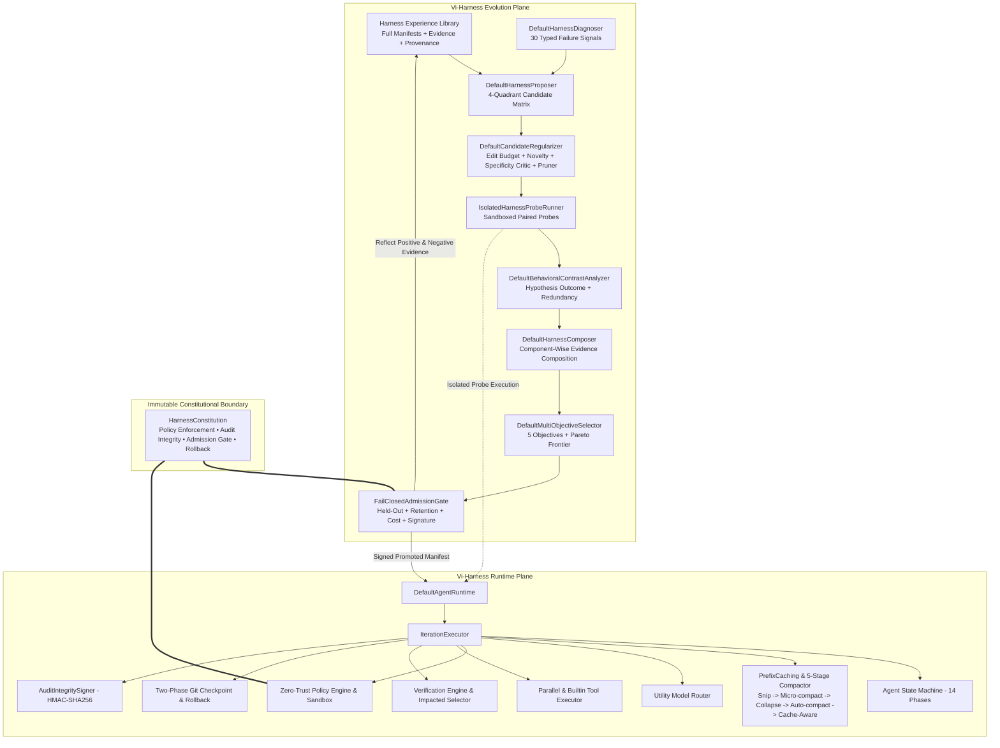
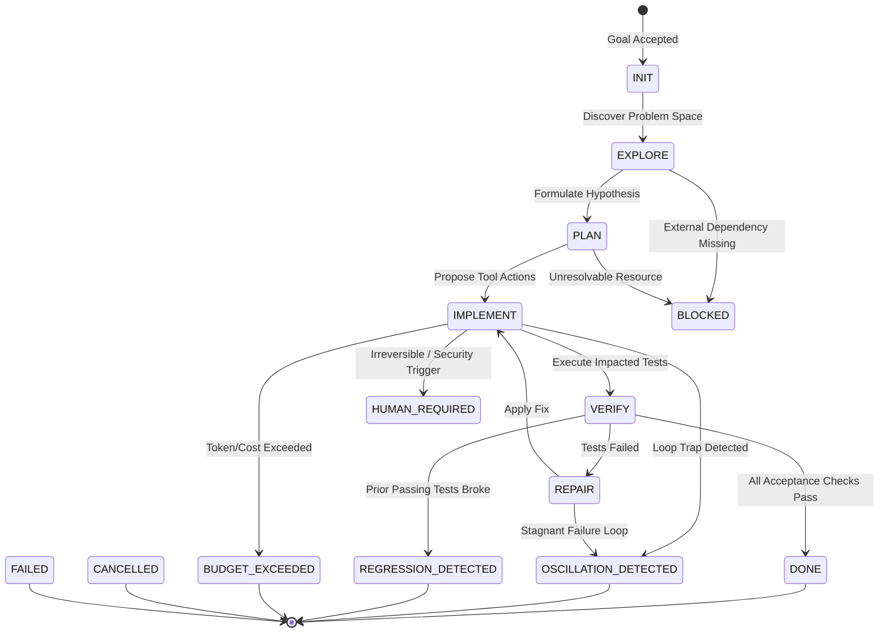

# Vi-Harness: Current Architecture Specification

## 1. Architectural Philosophy

Vi-Harness is built on two foundational theses:
1. **"The agent is not a persistent conversation. The agent is a stateful, evidence-driven state machine."**
2. **"Evidence-Gated Recursive Harnessing Under Zero-Trust Constraints."**

Vi-Harness separates execution from self-evolution into two distinct planes:
- **Runtime Plane (`src/runtime/`, `src/core/state-machine/`):** Executes a single frozen `HarnessManifest` deterministically through a 14-phase state machine, 5-stage progressive context compaction (`Snip → Micro-compact → Collapse → Auto-compact → Cache-Aware`, backed by `ContextCompressor`'s 6 internal execution tiers), parallel tool execution with mutation barriers, and verification-first completion.
- **Evolution Plane (`src/core/evolution/`, `src/infra/evolution/`):** Recursively improves harnesses via **Propose–Probe–Compose**, regularized candidate filtering (RRSI / HarnessCompass), isolated paired probes, multi-objective Pareto selection, capability retention testing (EvoHarnessBench), and a fail-closed admission gate (`FailClosedAdmissionGate`) governed by an immutable `HarnessConstitution`.

---

## 2. High-Level Dual-Plane System Architecture

---

## 3. Immutable Harness Constitution & Capability Classes

| Capability Class | Surfaces | Task Evidence Required | Global Promotion Required | Mutability |
| :--- | :--- | :--- | :--- | :--- |
| **GUIDANCE** | `systemPrompt`, `toolGuidance` | `E1_SINGLE_CONTRAST` | `E4_GENERALIZATION` | Evolvable in sandbox |
| **DECLARATIVE** | `guardrails`, `memoryPolicy`, `subagents`, `skills`, `contextPolicy`, `routingPolicy`, `verificationPolicy`, `toolSchedulingPolicy` | `E2_REPLICATED_CONTRAST` | `E4_GENERALIZATION` | Evolvable with Zod schema + regression checks |
| **EXECUTABLE** | `scripts`, `plugins` | `E3_VERIFIED` | `E4_GENERALIZATION` | Evolvable under `PreWriteSyntaxGate` + sandbox + zero privilege escalation |
| **CONSTITUTIONAL** | `policyEngine`, `auditSigner`, `sandboxConfinement`, `admissionGate`, `rollbackSemantics`, `testProtectionGate` | Immutable | Immutable | **Immutable by any optimizer** |

---

## 4. The 5-Tier Evidence Hierarchy (`E0`–`E4`)

| Level | Identifier | Meaning |
| :--- | :--- | :--- |
| **E0** | `E0_REFLECTION` | Observation or hypothesis inferred from traces only. |
| **E1** | `E1_SINGLE_CONTRAST` | Base and candidate executed on the same task and seed. |
| **E2** | `E2_REPLICATED_CONTRAST` | Multiple matched executions showing a repeatable behavioral difference. |
| **E3** | `E3_VERIFIED` | External verifier, tests, and zero policy violations independently sustain the effect. |
| **E4** | `E4_GENERALIZATION` | Inaccessible held-out/OOD evaluation and capability retention suites sustain the change. |

---

## 5. The 14 Canonical Agent Phases (Runtime Plane)

---

## 6. The Four-Tier Context Model (L0 - L3) & 5-Stage Compaction

| Tier | Name | Persistence | Typical Token Budget | Contents |
| :--- | :--- | :--- | :--- | :--- |
| **L0** | **Hot State** | Current Turn | 35-45% | Active goal, modified file buffers, immediate error stack traces, compiler output. |
| **L1** | **Working Memory** | Active Task | 20-30% | Execution plan checklist, current working hypothesis, recent decision records. |
| **L2** | **Episodic History** | Session | 10-15% | Condensed prior attempts, failed tool invocations, summarized branch outcomes. |
| **L3** | **Repository Knowledge** | Permanent | 20-40% | Coding standards, architectural rules, AST Repo-Map symbol graph. |

Progressive Compaction Pipeline (`ContextCompressor` + `CachePrefixTracker`):
`Snip → Micro-compact → Collapse → Auto-compact → Cache-Aware` (with internal `BUDGET_REDUCTION` and `TOOL_PRUNE` pre-stages).
