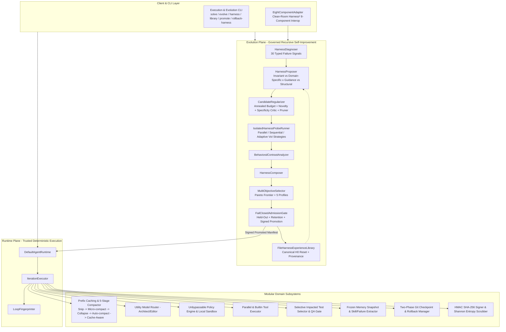

# Vi-Harness: Target Architecture Specification

## 1. Target Architecture Overview

The target state of Vi-Harness realizes **Evidence-Gated Recursive Harnessing Under Zero-Trust Constraints**: uniting a deterministic **Runtime Plane** (14-phase state machine, 5-stage context compaction `Snip → Micro-compact → Collapse → Auto-compact → Cache-Aware`, zero-trust sandbox) with a governed **Evolution Plane** (Harness² Propose–Probe–Compose, AHE falsifiable observability, RRSI/HarnessCompass regularization, HarnessOpt-Bench held-out admission, and EvoHarnessBench retention testing).

---

## 2. Key Architecture Invariants

1. **The Model Proposes, The Runtime Decides**:
   The LLM never directly executes commands, transitions state, or creates Git commits. All proposals pass through deterministic verification and policy evaluation.
2. **Runtime Plane vs Evolution Plane Separation**:
   The dependency direction is strictly `Evolution Plane -> Runtime interfaces`, never `Runtime core -> concrete Evolution implementation`.
3. **Immutable Harness Constitution**:
   The optimizer is never `root` over the system that evaluates and admits it. Constitutional components (`policy_engine`, `privilege_boundary`, `filesystem_confinement`, `secret_scrubber`, `audit_integrity_signer`, `admission_gate`, `rollback_manager`, `trusted_verification_boundary`) cannot be altered by self-evolution.
4. **Canonical Baseline Reset (`H0`)**:
   Every new task starts from the canonical baseline `H0` by default, using `FileHarnessExperienceLibrary` as retrieved evidence rather than chaining unpromoted task patches (`H0 -> H1 -> H2 -> ...`).
5. **Fail-Closed Held-Out Admission & Retention**:
   Global promotion requires `E4_GENERALIZATION` evidence on an inaccessible held-out partition, zero forgotten capabilities (`RetentionSuiteRunner`), bounded cost/latency regression, and HMAC-SHA256 signature verification.
6. **Sublinear Context Invariant**:
   Context size across long horizons ($N \ge 100$ iterations) is bounded by $O(\log N)$ or constant bounds via the 5-stage compaction pipeline (`Snip → Micro-compact → Collapse → Auto-compact → Cache-Aware`).
7. **Zero-Loss User Rollback & Tamper-Proof Audit**:
   Both workspace file checkpoints and promoted `HarnessManifest` baselines support instant, cryptographically verified rollback.
