# Vi-Harness: Enterprise Threat Model & Security Specification

## 1. Trust Boundaries & Actor Model

```mermaid
flowchart LR
    subgraph Untrusted [Untrusted Boundary]
        ModelOutput[LLM Output / Tool Proposals]
        CandidateProposal[Self-Evolution Candidate Proposals]
        UserWorkspace[Target Workspace Files]
        ExternalLogs[Third-Party Logs & Stderr]
    end

    subgraph Defense [Zero-Trust Security & Constitutional Perimeter]
        Constitution[Immutable HarnessConstitution]
        SurfaceRegistry[EvolvableSurfaceRegistry]
        Regularizer[BenchmarkSpecificityCritic & Regularizer]
        SyntaxGate[PreWriteSyntaxGate]
        RiskClassifier[RiskClassifier]
        PolicyEngine[Unbypassable PolicyEngine]
        SecretScrubber[SecretScrubber & Entropy Analyzer]
        PathValidator[Canonical PathValidator]
        CommandSanitizer[CommandSanitizer]
        AdmissionGate[FailClosedAdmissionGate]
        AuditSigner[HMAC SHA-256 Signer]
    end

    subgraph Trusted [Trusted Runtime & Canonical Baseline]
        CanonicalBaseline[Signed Canonical Baseline H0]
        ExecutionJournal[Cryptographic Execution Journal]
        StateStore[Verified State Store]
        ToolExecutor[Sandbox Tool Executor]
    end

    Untrusted --> Defense
    Defense --> Trusted
```

---

## 2. Runtime Plane STRIDE & OWASP LLM Threat Analysis

| Threat Category | Attack Vector | Vi-Harness Mitigation Engine | Verification Test |
| :--- | :--- | :--- | :--- |
| **Prompt Injection & Overrides** | Malicious text in files attempting to alter agent instructions | Context Sanitizer strips `<system_override>` tokens; Policy Engine evaluates actions independently of prompt claims. | `tests/unit/security/red-team-suite.test.ts` |
| **Arbitrary Command Execution** | LLM proposes `rm -rf /` or chained commands `cat file; sudo reboot` | `CommandSanitizer` and `CommandRestrictionRule` reject chained operators (`;`, `&&`, `|`) and enforce strict command allowlists. | `tests/unit/security/red-team-suite.test.ts` |
| **Path Traversal & Escape** | LLM attempts `../../etc/passwd` or `C:/Windows/System32` | `PathValidator` resolves real canonical paths, rejecting any path outside the authorized workspace root. | `tests/unit/security/red-team-suite.test.ts` |
| **Credential & Secret Exposure** | Tool outputs containing AWS keys, GitHub tokens, or private RSA keys | `SecretScrubber` applies regex scrubbing and Shannon entropy ($-\sum p_i \log_2 p_i \ge 4.5$) redaction before logging or context injection. | `tests/unit/security/audit-integrity-signer.test.ts` |
| **Log Tampering & Repudiation** | Malicious insider modifying execution logs or checkpoint manifests | `AuditIntegritySigner` signs all journal entries and checkpoint manifests with HMAC SHA-256. | `tests/unit/security/audit-integrity-signer.test.ts` |
| **Excessive Agency & Unbounded Loops** | Infinite recursive self-invocation or stagnation loops | `LoopFingerprinter` detects SHA-256 state repetition; `DefaultSubagentManager` enforces max depth $\le 3$. | `tests/unit/runtime/loop-fingerprinter.test.ts` |
| **Production Environment Impact** | Accidental deployment or modification of production targets | `ProductionProtectionRule` rejects or escalates any action referencing `/prod/i` or `environment: 'PRODUCTION'`. | `tests/unit/security/final-security-audit.test.ts` |

---

## 3. Evolution Plane Threat Model (Secure Recursive Self-Evolution)

Self-evolving agent harnesses introduce 22 distinct threats where the optimizer could compromise the system that governs or evaluates it. Vi-Harness enforces defense-in-depth across every threat:

| # | Evolution Threat | Attack / Failure Vector | Constitutional & Architectural Mitigation | Verification Suite |
| :--- | :--- | :--- | :--- | :--- |
| **E-01** | **Optimizer disables its own guardrails** | Candidate mutates `policy_engine` or injects `DISABLE_POLICY_ENGINE` | `ConstitutionValidator` locks all 8 `CONSTITUTIONAL` surfaces and blocks bypass directives across all payloads. | `milestone-a-foundations.test.ts`, `mutation-contracts.test.ts` |
| **E-02** | **Candidate grants itself additional authority** | Candidate sets `sandboxMode: 'NONE'` or `GRANT_ROOT_PRIVILEGE` | `HarnessManifest.securityProfile` is verified against `DEFAULT_HARNESS_CONSTITUTION.constitutionHash`; privilege expansion is rejected and quarantined. | `milestone-a-foundations.test.ts`, `milestone-b-c-d-e-f.test.ts` |
| **E-03** | **Malicious or poisoned experience entry** | Corrupted or adversarial entry injected into `.vi-evolution/libraries/` | Every `ExperienceEntry` carries an HMAC-SHA256 `auditSignature` and `manifestHash`; conflicting entries are quarantined via `deduplicateAndConsolidate()`. | `milestone-b-c-d-e-f.test.ts` |
| **E-04** | **Malicious skill poisoning** | Skill manifest contains prompt injection or destructive instructions | `DefaultHarnessSurfaceRegistry` validates skills against `SkillItemSchema` and `ConstitutionValidator.validateDirectivePayload()`. | `milestone-a-foundations.test.ts` |
| **E-05** | **Malicious plugin persisted into library** | Irreversible plugin hooks into tool pipeline to exfiltrate data | Plugins require `EXECUTABLE` capability class (`E3_VERIFIED` for task, `E4_GENERALIZATION` for promotion) and reversible disposer validation. | `milestone-a-foundations.test.ts` |
| **E-06** | **Benchmark-data leakage** | Candidate memorizes `django__django-11099` or fixture paths | `BenchmarkSpecificityCritic` inside `DefaultCandidateRegularizer` scans diffs and payloads for benchmark IDs, fixture paths, and task conditionals. | `milestone-b-c-d-e-f.test.ts` |
| **E-07** | **Rubric leakage** | Candidate fetches online rubric or hardcodes `FAIL_TO_PASS` | `IsolatedHarnessProbeRunner` enforces `networkEgressPolicy: 'DENY_ALL'` during probes; `BenchmarkSpecificityCritic` blocks rubric tokens. | `milestone-b-c-d-e-f.test.ts` |
| **E-08** | **Reward hacking** | Candidate optimizes Pass@1 by exploding token usage or disabling checks | `DefaultMultiObjectiveSelector` penalizes cost, latency, tool errors, and regressions across a 5-dimension Pareto frontier. | `milestone-b-c-d-e-f.test.ts` |
| **E-09** | **Verifier gaming** | Candidate attempts to weaken `trusted_verification_boundary` or test files | `trusted_verification_boundary` is `CONSTITUTIONAL` (immutable), and `TestProtectionGate` blocks modification of protected test suites. | `milestone-a-foundations.test.ts` |
| **E-10** | **Candidate hides behavior from audit** | Candidate attempts to suppress trace emission or alter `audit_integrity_signer` | `audit_integrity_signer` is `CONSTITUTIONAL`; probe telemetry is captured externally by `IsolatedHarnessProbeRunner`. | `evolution-lifecycle.test.ts` |
| **E-11** | **Candidate modifies logging** | Candidate mutates logger configuration to mask errors | Logging and telemetry sinks live outside `DefaultHarnessSurfaceRegistry` and cannot be targeted by candidate diffs. | `milestone-a-foundations.test.ts` |
| **E-12** | **Candidate modifies promotion criteria** | Candidate attempts to lower `admission_gate` thresholds | `admission_gate` is a locked `CONSTITUTIONAL` surface; `FailClosedAdmissionGate` runs outside the candidate's execution context. | `milestone-a-foundations.test.ts` |
| **E-13** | **Evolution-library supply-chain attack** | External 8-component tree imported with `disableSandbox: true` | `EightComponentAdapter.importTree()` rejects any external tree requesting disabled sandbox or unrestricted network egress. | `milestone-b-c-d-e-f.test.ts` |
| **E-14** | **Dependency injection through generated script** | Generated script contains syntax hallucinations or markdown fences | Every `scripts` surface is validated in-memory by `PreWriteSyntaxGate` before manifest validation or probe execution. | `milestone-a-foundations.test.ts`, `mutation-contracts.test.ts` |
| **E-15** | **Cross-task memory poisoning** | Unpromoted task patch silently becomes baseline for next task | Canonical Baseline Reset Invariant: every new task starts from `H0` (`FailClosedAdmissionGate.getCanonicalBaseline()`), never chaining unpromoted patches. | `evolution-lifecycle.test.ts` |
| **E-16** | **Stale experience causing unsafe behavior** | Outdated library entries misguide future proposals | `ExperienceEntry` includes `expiresAt` TTL and `FileHarnessExperienceLibrary.prune()` / `invalidate()` lifecycle management. | `milestone-b-c-d-e-f.test.ts` |
| **E-17** | **Model-generated provenance forgery** | Forged `AdmissionDecision` signature passed to `promoteToCanonicalBaseline()` | `FailClosedAdmissionGate.verifyDecisionSignature()` verifies HMAC-SHA256 signatures before mutating canonical baseline history. | `mutation-contracts.test.ts` |
| **E-18** | **Symlink/path bypass inside candidate worktrees** | Probe attempts to escape isolated temp workspace | `IsolatedHarnessProbeRunner` creates dedicated `os.tmpdir()` probe directories and cleans them up in `finally` blocks; `PathValidator` confines paths. | `milestone-b-c-d-e-f.test.ts` |
| **E-19** | **Network exfiltration during probes** | Probe attempts outbound network requests to exfiltrate code or fetch answers | `IsolatedHarnessProbeRunner` and `HarnessConstitution` enforce restricted/denied network egress (`allowUnrestrictedNetworkInProbes: false`). | `milestone-a-foundations.test.ts` |
| **E-20** | **Candidate consuming unbounded compute** | Runaway recursion loop or expensive candidate probes | `AdaptiveRecursionBudgetPolicy` enforces hard caps on `maxTotalTokens`, `maxTotalCostDollars`, `maxWallTimeMs`, and marginal VoI stopping. | `milestone-b-c-d-e-f.test.ts` |
| **E-21** | **Self-replication through plugins** | Plugin attempts to spawn recursive evolution engines | Evolution Plane is never exposed as a tool to the Runtime Plane (`Evolution Plane -> Runtime interfaces` one-way dependency). | `architecture-sync.test.ts` |
| **E-22** | **Capability accumulation without privilege revocation** | Promoted harness introduces subtle regression or capability forgetting | `RetentionSuiteRunner` checks 11 capability categories (`forgottenCount === 0` required), and `rollbackBaseline()` restores `H0` instantaneously. | `milestone-b-c-d-e-f.test.ts`, `evolution-lifecycle.test.ts` |
